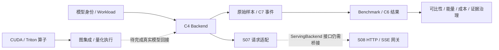

# HeteroQuantServeBench

HQSB 是面向 NVIDIA CUDA 与 Ascend/CANN 的推理优化实验项目：从模型基线和 profiling，追踪算子、量化、Runtime、Serving 到跨硬件评估的证据链。

**当前状态：可运行的 CUDA/模型基线 + 多阶段契约与研究脚手架，尚未完成 S00–S15 全部实验验收。** 后期模块中的 `smoke`、接口解析通过、配置审计通过，均不代表模型级优化或生产部署已验证。S03/S04 的部分原始实验还有 FAIL，S04.5 未闭环，S05-02/03/04 仍为 BLOCKED。

- [项目现状总览](docs/project_status.md)：逐阶段状态、已修复问题、剩余缺口。
- [使用说明书](docs/manual/使用说明书.md)：环境、入口、数据流、常用操作、扩展方式。
- [逐文件/API 索引](docs/manual/generated/README.md)：源码、脚本、配置、测试、文档的作用、接口、依赖和调用者。
- [全仓库审查报告](docs/audit/全项目审查报告_20260920.md)：发现依据、修改边界和测试证据。
- [独立功能测试报告](docs/audit/全项目功能测试报告_20260920.md)：新增 36 条用例的场景、预期/实际结果，完整回归与真实模型 smoke。
- [阶段设计](docs/stages/) / [模块边界](docs/architecture/module_ownership.md)：设计目标与依赖规则。

## 本项目的执行方式

Mac 用于编辑和版本管理；运行、构建、测试与硬件探测全部通过 Jetson 代理。下列命令在 **Mac 项目根目录**输入：

```bash
# 同步预览，然后同步源码；不覆盖远端 raw、模型或 build
./scripts/sync_to_jetson.sh --dry-run
./scripts/sync_to_jetson.sh

# 软件回归：保存命令、源码哈希、pytest XML、原始日志和 summary
./scripts/remote_run.sh python3 scripts/audit/run_project_audit.py

# 验证不含私有实验数据的新检出也能通过
./scripts/remote_run.sh python3 scripts/audit/run_project_audit.py --clean-source

# 本轮临时工具环境中的 Ruff；公共文档链接
./scripts/remote_run.sh env PYTHONPATH=/tmp/hqsb-audit-tools \
  python3 -m ruff check hqsb ops scripts tests benchmarks
./scripts/remote_run.sh python3 scripts/check_docs.py
```

默认开发执行端为 `3090-inf:/root/HeteroQuantServeBench`。Mac 只编辑与管理版本，运行、构建和测试继续通过代理。`HQSB_REMOTE_HOST`、`HQSB_REMOTE_DIR` 可覆盖目标；Jetson 通过 `--target jetson` 显式同步。自动保存不等同于已验证同步。工作台 SSH / HTTP 机器管理及切换见[机器连接说明](infra/README.machine-connections.md)。

新增 4090D / Linux x86_64 CUDA 后端的初始化流程见 [CUDA Console 部署说明](infra/README.cuda-console.md)。通过 `HQSB_REMOTE_HOST=4090D-hqsb` 选择该端，或使用 `scripts/sync_to_jetson.sh --target 4090d` 同步；Jetson 执行端继续保留。`scripts/console/bootstrap_cuda.sh` 复用目标 CUDA PyTorch，在隔离环境安装已锁定的模型依赖、校验权重、按实际 SM 构建算子并构建前端。通用服务配置为 `configs/console/cuda.example.yaml`。

4090D 多厂商模型、ModelScope 权重校验、模型切换及观测边界见 [多模型接入说明](infra/README.modelscope-models.md)，目标配置为 `configs/console/4090d-models.yaml`。

CPU 回归表示“不使用加速器”，并不表示“只安装 core 就能跑所有测试”：部分测试需要 CPU 可用的 torch 等 benchmark 依赖。Jetson 必须保留 NVIDIA 提供的 torch wheel，勿直接用普通 PyPI torch 替换。首次安装、CUDA 构建和模型运行见使用说明书。

## 主要工作流



`hqsb/` 是 Python 库；`ops/` 是算子与硬件调用层；`scripts/` 是操作/实验入口；`configs/` 是配置和冻结词汇表；`tests/` 是软件验证；`docs/stage_experiments/` 是被 Git 忽略的本机实验档案。完整源码检出不会自动获得这些私有原始证据。

项目原则：先 profiling，再优化；先 correctness，再性能；先证据，再声明。没有测量就保留缺失状态，不用模拟数字代替硬件收益。

## Web Console

`web/console/` 提供浏览器推理工作台，`hqsb/console/` 提供认证、真实流式推理、取消、任务持久化与历史证据 API。默认开发服务运行在 `3090-inf`，可在界面通过 SSH / HTTP 选择其他 HQSB 节点；未验证的量化与自定义算子模型回接不会在页面中假装可用。

Console v0.2 增加阶段与逐 token 观测、有限窗口 CPU/CUDA profiler、trace 查询/下载、内存归因与张量账本、历史 kernel 证据钻取，以及真实 RTN-W4/W8 制品任务。量化制品与在线低比特部署分开，优化导出保留为待验证假设。测试范围见 [v0.2 验收报告](docs/audit/HQSB_Console_v0.2_验收报告_20260921.md)。

v0.2.1 新增侧栏「内存与数据流」：共享 DRAM 与 allocator 结构、可点击权重矩形图、逐层 KV 图、请求流程与实际 CUDA copy 方向。默认回放已有真实采集，模型卸载后仍可查看绑定加载记录；显式 memcpy 字节不等于全部内存读写。验证见 [可视化验收报告](docs/audit/HQSB_Console_v0.2.1_可视化验收报告_20260921.md)。

启动与开发见 [Console 入口说明](web/console/README.md)，逐页操作与指标口径见 [前端使用说明书](docs/manual/前端使用说明书.md)。Console 使用独立版本的交互计时，不改变既有 C4/C6/C7 基准契约。

## 单机真实模型机制观测

新增独立的 `hqsb.observation` 证据层。Console 的「布局与系统机制」支持权重/KV 的 shape、stride、storage 去重、PyTorch 分配器快照与地址复用、CPU 进程内存/缺页、VMA 和有界页状态样本，并提供按哈希核验的原件下载与两次运行的描述性对照。`save_input=false` 时只保留输入身份哈希，不保存输入 token。

本轮在 Jetson 隔离目录 `/home/jetson/work/HQSB-observation-20261014` 验证，保留原远端 checkout 的已有工作。使用下列新功能命令前，先在当前 Mac 终端设置 `HQSB_REMOTE_DIR`；测试服务已停止，可按 Console 入口说明自行启动该目录的服务。

| 模式 | 声明的观测范围 |
|---|---|
| `off` | 推理结果与计时基线，不生成机制观测包 |
| `basic` | 阶段/token 元数据、关键点 KV、250 ms OS 汇总；开销需实测 |
| `memory` | basic + VMA、原生分配事件/快照、虚拟地址与 storage 关联 |
| `pages` | basic + VMA、最多 4096 个匿名 CPU 页的只读状态样本 |
| `operators` | basic + 全部 decoder 根模块注解与有限窗口 CPU/CUDA profiler |

```bash
# 在 Mac 项目根目录输入；实际计算只在远端进行
export HQSB_REMOTE_HOST=jetson
export HQSB_REMOTE_DIR=/home/jetson/work/HQSB-observation-20261014
./scripts/remote_run.sh python3 scripts/observation/run_model_observation.py \
  --mode memory --isl 128 --osl 16 \
  --manifest docs/benchmark/model_sha256_manifest.txt

# 每个样本独立进程，AB/BA 交替；保留失败记录，不自动宣称低开销
./scripts/remote_run.sh python3 scripts/observation/run_campaign.py \
  --kind overhead --mode basic --pairs 10 --isl 128 --osl 64 \
  --manifest docs/benchmark/model_sha256_manifest.txt

# 描述性机制对照：释放空闲块 / 保留 allocator 缓存，不宣称加速
./scripts/remote_run.sh python3 scripts/observation/run_campaign.py \
  --kind cleanup --mode memory --pairs 1 --isl 128 --osl 9 \
  --manifest docs/benchmark/model_sha256_manifest.txt

# 独立管理员 Nsight 诊断；--nvtx 显式打开工具阶段范围
./scripts/remote_run.sh python3 scripts/observation/run_capture.py \
  --tool ncu --phase prefill --launch-count 1 --kernel-filter '.*gemm.*' \
  --output experiment_results/OBS/tools/my-unique-capture -- \
  python3 scripts/observation/run_model_observation.py --nvtx --mode off --isl 128 --osl 2
```

原始 JSONL、SHA-256 和冻结 manifest 存在 `experiment_results/OBS/` 或 Console 私有 `captures/<run_id>/observations/`；高频数据不写入 SQLite 或 SSE。采集失败、工具缺失、权限不足和记录丢失均保留状态。Tegra 的计数器权限使用既有管理员运行方式，不修改系统全局权限。

内存口径不能相加；CPU 页样本不是 GPU 页表；allocator 虚拟地址不是物理地址。Nsight 计数器属于单独诊断运行的选定 kernel。当前机制比较始终保留质量 `not_evaluated` 与采用决策 `hold`，模型优化是否更好还需要质量门和独立性能实验。模块接口、已执行验收和剩余边界见 [实现与验收记录](docs/architecture/HQSB_观测闭环实现与验收_20261014.md)。

## 优化实验：计划、生效凭据与质量对照（G01–G08）

新增实验组合层复用现有模型 worker 和观测归档，不改变 C4/C6/C7 或原 `/observation-comparisons` 的语义。目前可执行措施为 `cleanup_policy`、`output_budget`，以及在加载配置中指定的 `attention_backend`；其他十层措施有能力目录，但未接入的措施会被拒绝。SDPA 在现有 vendor wheel 上仍需实际兼容验证，不自动回退。

`POST /api/console/v1/experiments/plans` 冻结 baseline/candidate、声明变更、工作量、质量合同和机制预期；`POST /experiments/{id}/jobs` 通过现有串行 worker 执行 performance/diagnostic/quality 角色。质量任务在既有 generate 操作内显式委派，`config.experiment_role=quality`，不增加旧任务枚举，也不提供推理性能样本。`GET /experiments/{id}/report` 汇总生效凭据、质量、性能、机制差异、缺失/失败配对及判定。所有接口继续使用已有认证和 epoch/取消协议。

```bash
# 在 Mac 项目根目录输入，执行仍在隔离 Jetson checkout
export HQSB_REMOTE_HOST=jetson
export HQSB_REMOTE_DIR=/home/jetson/work/HQSB-g01-g08-20261014
./scripts/remote_run.sh python3 scripts/observation/run_experiment.py \
  --spec configs/experiments/g01_cleanup.json \
  --manifest docs/benchmark/model_sha256_manifest.txt
```

CLI 在每个样本的独立进程中加载同一模型，AB/BA 交替，保存注册计划、每次尝试、命令、日志/结果哈希及失败记录。参考配置是软件/机制闭环 fixture，不是任务质量基准。质量采用逐位置完整词表 float32 logits、teacher-forced NLL/PPL、greedy 自由生成和可选 exact-match；超 token/字节预算明确失败，不截断后标为完整。API 同 worker 重复样本不满足独立进程性能门。完整数值相等也不能自动证明模型任务准确率足够。

`ObservationPlan.sources` 可以组合 allocator/pages/operators；保留旧五种模式默认行为。详细数据走有界文件，SQLite/SSE 只保留任务和摘要。优化凭据与质量原件通过监督者封存、fsync 和 SHA-256 核验后提供认证下载；取消/错误保留 partial。来源缺失不是零，生成上下文分叉后的机制仅作描述。源码补丁、模型身份、dtype/kernel 的比较必须精确预先声明；它们的比较支持不表示对应优化执行器已接入。

接口和边界详见 [G01–G08 实施与验证记录](docs/architecture/HQSB_G01_G08_实施与验证_20261014.md)。

### 前端与 G01–G08 服务联通

导航中的「优化实验」（`/optimization`）使用同源接口，测试阶段默认免登录：注册并冻结 JSON 配置 → 选择已就绪的 PyTorch 部署 → 串行执行未提交的 performance/diagnostic/quality 槽位 → 查看后端比较报告 → 从运行详情下载封存原件。`GET /experiments` 提供分页计划索引，`GET /experiments/{id}/jobs` 提供槽位状态。刷新按原实验 ID 恢复；接受过的槽位，包括失败和取消，不会自动重提。离开页面停止后续自动提交，已接受任务仍可在运行记录取消；显式停止会等待提交返回 ID 后请求取消。

普通推理工作台可以选择 allocator 清理策略，并传给已有优化配置解析。运行详情新增「优化与质量凭据」，同时展示 requested/resolved/effective、独立质量协议和经过 SHA-256 验证的下载链接。机制报告提供指标筛选与原始 seq；缺失保持未知，质量 fixture 不能代表通用准确率，同 worker 性能不能替代独立进程验收。

2026-10-16 的 Jetson 测试服务位于独立 checkout `/home/jetson/work/HQSB-benchmark-ui-20261016`，监听 `127.0.0.1:8768`，沿用 `/home/jetson/work/HQSB-g01-g08-20261014/.console/connected/` 的运行和实验数据；原 8767 实例保留。当前默认开发服务已迁至 3090；如需查看 Jetson 原服务，可使用独立转发入口：

```bash
ssh -N -L 127.0.0.1:8890:127.0.0.1:8768 jetson@192.168.10.7
# 浏览器打开 http://127.0.0.1:8890/benchmarks
# 测试模式直接进入，无需 API Key 或访问令牌。
```

当前实例重启时继续使用原来的已验证权重配置和数据目录，需已构建 `web/console/dist`，不能并行启动两个使用同一数据目录的实例。需要恢复认证时添加 `--require-auth` 或配置 `auth_required: true`：

```bash
export HQSB_REMOTE_HOST=jetson
export HQSB_REMOTE_DIR=/home/jetson/work/HQSB-benchmark-ui-20261016
./scripts/remote_run.sh env \
  HQSB_CONSOLE_DATA=/home/jetson/work/HQSB-g01-g08-20261014/.console/connected \
  HQSB_EVIDENCE_ROOT=/home/jetson/work/HQSB-g01-g08-20261014 \
  python3 -m hqsb.console --port 8768 --privileged-worker \
  --config /home/jetson/work/HQSB-benchmark-ui-20261016/reports/console/benchmark-ui/service.yaml
```

### 固定输入的性能与质量对照

进入“评测 → 性能与质量对照”（`/benchmarks`），默认预选四个版本化用例：算术短答案、JSON 结构化提取、上下文检索、开放解释。输入原文可展开，输入及计划保存 SHA-256。选择一个基线和最多三个候选方案，统一 greedy 与输出预算，直接开始对照。默认候选为 RMSNorm half2 v2 和局部融合 v1；原生制品不可用时对应候选禁用。`/playground` 保留为交互推理案例，`/optimization` 保留为高级预注册实验。

每个方案、每个用例先预热一次，再测量 1–5 次。服务端按方案串行切换和重载模型，刷新或离开浏览器不改变执行；同一时刻只允许一轮对照占用控制面，结束或取消后尝试恢复原部署。服务重启将未结束对照标为 `interrupted`，保留已接受任务，不自动重提，也不承诺恢复重启前的模型进程。

按用例分别展示输出、参考答案正确率、基线 Token 一致率、首 Token、生成 E2E、Decode 吞吐、输入/输出 Token 数与峰值分配内存。前三个用例按固定答案评分，开放解释没有客观分；一致率不等于正确率，达到输出预算会显示可能截断。只有完整且生效凭据、输入 Token、实际输出数量和模型/源码/分词器身份可对齐时才显示 E2E 相对值。计时不含加载、分词、预热、归档和评分；同 worker 快速比较不能替代独立进程 AB/BA 正式性能验收。

`GET /benchmark-catalog` 返回固定输入、目录与默认值；`POST /benchmarks` 冻结并执行，`GET /benchmarks`、`GET /benchmarks/{id}` 和 `POST /benchmarks/{id}/cancel` 提供历史、详情与取消。浏览器仅提交固定 ID 和有界预算，不能提交自定义路径或提示词。计划、角色、repeat、run ID、输出与投影凭据原子保存到数据目录 `benchmarks/bench_*.json`；生成原件继续使用已有 SQLite 运行记录与封存 capture。每次运行的 `config.benchmark_links` 反向关联本轮对照、用例和方案。可选内存/KV/系统页诊断独立执行，排除在性能统计之外；缺失指标保持未知。

2026-10-16 已在 Jetson 验证 Qwen3-1.7B 的 native / RMSNorm half2 v2 / 局部融合 v1 三方案四用例，共 12 次预热、12 次测量，核对全部测量凭据与封存原件。另验证独立内存诊断、在运行中取消、原方案恢复、刷新不重提、桌面/小屏及免登录；升级前 143 条运行记录 SHA-256 未变。检索用例三方案均输出错误值 `blue39`，保留正确率 0 与一致率 1；开放任务保持未评分。私有原始证据与功能验收位于 `reports/console/benchmark-ui/`，不构成优化采用或通用质量结论。

### 推理界面的算子替换

打开 `/playground`，在“执行配置 → 算子实现与版本”选择一个明确版本的方案。当前提供框架原生、RMSNorm scalar v1 / half2 v2、残差归一化、SiLU×up、RoPE、cuBLASLt、小 M GEMV、SDPA math / flash 和两种组合方案；未列出的算子保留原实现。选择后点击“加载并应用算子”或“应用并重载模型”，等待新部署版本就绪，再开始推理。待应用选择与当前实际加载方案分别显示；版本不一致时不能开始推理。切换需要重新加载模型。

“本次运行凭据与观测”显示 requested/resolved/effective、实际算子版本、Prefill/Decode 逻辑调用计数、未执行站点和 fallback，并提供封存的计划、绑定、汇总及执行凭据下载。阶段/token/allocator 摘要与内存、KV、OS 页、GPU profiler 的详细页面关联到同一个 run ID。逻辑调用证明与 GPU 活动、物理访存、质量和性能验收各有独立口径。

`GET /api/console/v1/kernels/profiles?deployment_id=<id>` 提供部署级目录与制品文件身份检查；仅目录可读不代表模型加载通过。管理员通过 `kernel_manifest` 配置原生库的固定 manifest，浏览器不能提交库路径。当前服务绑定内容寻址制品；缺失或哈希不符的方案会禁用，worker 加载时仍校验 ABI、torch/CUDA/SM 及模型适配。默认继续免登录，默认加载方案仍为 `framework-native`。
