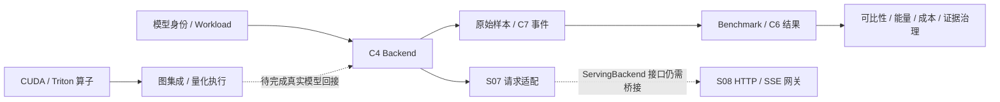

# HeteroQuantServeBench

HQSB 是面向 NVIDIA CUDA 与 Ascend/CANN 的推理优化实验项目：从模型基线和 profiling，追踪算子、量化、Runtime、Serving 到跨硬件评估的证据链。

**当前状态：可运行的 CUDA/模型基线 + 多阶段契约与研究脚手架，尚未完成 S00–S15 全部实验验收。** 后期模块中的 `smoke`、接口解析通过、配置审计通过，均不代表模型级优化或生产部署已验证。S03/S04 的部分原始实验还有 FAIL，S04.5 未闭环，S05-02/03/04 仍为 BLOCKED。

- [项目现状总览](docs/project_status.md)：逐阶段状态、已修复问题、剩余缺口。
- [使用说明书](docs/manual/使用说明书.md)：环境、入口、数据流、常用操作、扩展方式。
- [逐文件/API 索引](docs/manual/generated/README.md)：源码、脚本、配置、测试、文档的作用、接口、依赖和调用者。
- [全仓库审查报告](docs/audit/全项目审查报告_20260920.md)：发现依据、修改边界和测试证据。
- [独立功能测试报告](docs/audit/全项目功能测试报告_20260920.md)：新增 36 条用例的场景、预期/实际结果，完整回归与真实模型 smoke。
- [阶段设计](docs/stages/) / [模块边界](docs/architecture/module_ownership.md)：设计目标与依赖规则。

## 本项目的执行方式

Mac 用于编辑和版本管理；运行、构建、测试与硬件探测全部通过 Jetson 代理。下列命令在 **Mac 项目根目录**输入：

```bash
# 同步预览，然后同步源码；不覆盖远端 raw、模型或 build
./scripts/sync_to_jetson.sh --dry-run
./scripts/sync_to_jetson.sh

# 软件回归：保存命令、源码哈希、pytest XML、原始日志和 summary
./scripts/remote_run.sh python3 scripts/audit/run_project_audit.py

# 验证不含私有实验数据的新检出也能通过
./scripts/remote_run.sh python3 scripts/audit/run_project_audit.py --clean-source

# 本轮临时工具环境中的 Ruff；公共文档链接
./scripts/remote_run.sh env PYTHONPATH=/tmp/hqsb-audit-tools \
  python3 -m ruff check hqsb ops scripts tests benchmarks
./scripts/remote_run.sh python3 scripts/check_docs.py
```

默认远端为 `jetson@192.168.10.7:/home/jetson/work/HeteroQuantServeBench`。`HQSB_REMOTE_HOST`、`HQSB_REMOTE_DIR` 可统一覆盖运行、同步和拉取目标。自动保存不等同于已验证同步。

CPU 回归表示“不使用加速器”，并不表示“只安装 core 就能跑所有测试”：部分测试需要 CPU 可用的 torch 等 benchmark 依赖。Jetson 必须保留 NVIDIA 提供的 torch wheel，勿直接用普通 PyPI torch 替换。首次安装、CUDA 构建和模型运行见使用说明书。

## 主要工作流



`hqsb/` 是 Python 库；`ops/` 是算子与硬件调用层；`scripts/` 是操作/实验入口；`configs/` 是配置和冻结词汇表；`tests/` 是软件验证；`docs/stage_experiments/` 是被 Git 忽略的本机实验档案。完整源码检出不会自动获得这些私有原始证据。

项目原则：先 profiling，再优化；先 correctness，再性能；先证据，再声明。没有测量就保留缺失状态，不用模拟数字代替硬件收益。

## Web Console

`web/console/` 提供浏览器推理工作台，`hqsb/console/` 提供认证、真实流式推理、取消、任务持久化与历史证据 API。默认通过远端 Jetson 上的 Qwen3 FP16 Reference 运行；未验证的量化与自定义算子模型回接不会在页面中假装可用。

Console v0.2 增加阶段与逐 token 观测、有限窗口 CPU/CUDA profiler、trace 查询/下载、内存归因与张量账本、历史 kernel 证据钻取，以及真实 RTN-W4/W8 制品任务。量化制品与在线低比特部署分开，优化导出保留为待验证假设。测试范围见 [v0.2 验收报告](docs/audit/HQSB_Console_v0.2_验收报告_20260921.md)。

v0.2.1 新增侧栏「内存与数据流」：共享 DRAM 与 allocator 结构、可点击权重矩形图、逐层 KV 图、请求流程与实际 CUDA copy 方向。默认回放已有真实采集，模型卸载后仍可查看绑定加载记录；显式 memcpy 字节不等于全部内存读写。验证见 [可视化验收报告](docs/audit/HQSB_Console_v0.2.1_可视化验收报告_20260921.md)。

启动与开发见 [Console 入口说明](web/console/README.md)，逐页操作与指标口径见 [前端使用说明书](docs/manual/前端使用说明书.md)。Console 使用独立版本的交互计时，不改变既有 C4/C6/C7 基准契约。

## 单机真实模型机制观测

新增独立的 `hqsb.observation` 证据层。Console 的「布局与系统机制」支持权重/KV 的 shape、stride、storage 去重、PyTorch 分配器快照与地址复用、CPU 进程内存/缺页、VMA 和有界页状态样本，并提供按哈希核验的原件下载与两次运行的描述性对照。`save_input=false` 时只保留输入身份哈希，不保存输入 token。

本轮在 Jetson 隔离目录 `/home/jetson/work/HQSB-observation-20261014` 验证，保留原远端 checkout 的已有工作。使用下列新功能命令前，先在当前 Mac 终端设置 `HQSB_REMOTE_DIR`；测试服务已停止，可按 Console 入口说明自行启动该目录的服务。

| 模式 | 声明的观测范围 |
|---|---|
| `off` | 推理结果与计时基线，不生成机制观测包 |
| `basic` | 阶段/token 元数据、关键点 KV、250 ms OS 汇总；开销需实测 |
| `memory` | basic + VMA、原生分配事件/快照、虚拟地址与 storage 关联 |
| `pages` | basic + VMA、最多 4096 个匿名 CPU 页的只读状态样本 |
| `operators` | basic + 全部 decoder 根模块注解与有限窗口 CPU/CUDA profiler |

```bash
# 在 Mac 项目根目录输入；实际计算只在远端进行
export HQSB_REMOTE_DIR=/home/jetson/work/HQSB-observation-20261014
./scripts/remote_run.sh python3 scripts/observation/run_model_observation.py \
  --mode memory --isl 128 --osl 16 \
  --manifest docs/benchmark/model_sha256_manifest.txt

# 每个样本独立进程，AB/BA 交替；保留失败记录，不自动宣称低开销
./scripts/remote_run.sh python3 scripts/observation/run_campaign.py \
  --kind overhead --mode basic --pairs 10 --isl 128 --osl 64 \
  --manifest docs/benchmark/model_sha256_manifest.txt

# 描述性机制对照：释放空闲块 / 保留 allocator 缓存，不宣称加速
./scripts/remote_run.sh python3 scripts/observation/run_campaign.py \
  --kind cleanup --mode memory --pairs 1 --isl 128 --osl 9 \
  --manifest docs/benchmark/model_sha256_manifest.txt

# 独立管理员 Nsight 诊断；--nvtx 显式打开工具阶段范围
./scripts/remote_run.sh python3 scripts/observation/run_capture.py \
  --tool ncu --phase prefill --launch-count 1 --kernel-filter '.*gemm.*' \
  --output experiment_results/OBS/tools/my-unique-capture -- \
  python3 scripts/observation/run_model_observation.py --nvtx --mode off --isl 128 --osl 2
```

原始 JSONL、SHA-256 和冻结 manifest 存在 `experiment_results/OBS/` 或 Console 私有 `captures/<run_id>/observations/`；高频数据不写入 SQLite 或 SSE。采集失败、工具缺失、权限不足和记录丢失均保留状态。Tegra 的计数器权限使用既有管理员运行方式，不修改系统全局权限。

内存口径不能相加；CPU 页样本不是 GPU 页表；allocator 虚拟地址不是物理地址。Nsight 计数器属于单独诊断运行的选定 kernel。当前机制比较始终保留质量 `not_evaluated` 与采用决策 `hold`，模型优化是否更好还需要质量门和独立性能实验。模块接口、已执行验收和剩余边界见 [实现与验收记录](docs/architecture/HQSB_观测闭环实现与验收_20261014.md)。
