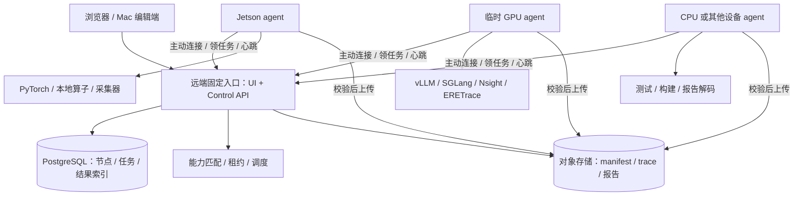

# HQSB 中心控制与弹性算力节点设计

日期：2026-10-21。状态：后续架构方案；当前交付为主服务回迁 Jetson，分布式控制协议尚待实现。

## 1. 目标与可用性契约

浏览器始终访问固定入口。节点加入、维护、关机或实例更换后，模型目录、历史记录、诊断结果和任务提交入口继续由中心提供。算力不足时任务进入等待，界面显示所需资源与当前容量。正在故障节点上生成的请求可能中断；跨机器续接 GPU KV / CUDA 上下文需专门迁移机制。初期恢复以独立的新 attempt 执行为单位。

“全部算力均为节点”包含 Jetson、临时3090/4090、CPU测试机和后续 Ascend。中心自身只有控制资源，GPU 执行由节点负责。代码编辑端是 Mac；固定入口、数据库、证据存储、任务调度、节点连接都部署在远端，运行链路无需 Mac 中转。

区分三件事：节点注册扩缩容、节点模型加载卸载、云实例创建销毁。第一阶段完成前两项；云资源供应商适配是后续可选模块，关机/销毁只在排空与证据同步后发起。

## 2. 部署选择

| 方案 | 放置方式 | 优点 | 限制 / 适合阶段 |
|---|---|---|---|
| Jetson 暂驻中心 | 当前 API/UI/数据库在 Jetson；同板 GPU 作为执行资源 | 可立即恢复开发，利用现有设备 | 断电/家庭网络影响入口；模型与构建占用同一内存。作为当前过渡 |
| 常驻云 CPU 主机 + 对象存储 | 独立 CPU VPS/云主机运行 UI/API/调度；Jetson 与租赁 GPU 为节点 | GPU实例释放后控制入口与记录保留；固定公网或私网地址 | 增加常驻主机与存储费用。推荐目标 |
| 可长期使用的学校/实验室服务器 | 在获准的远端服务器上部署中心，外部 GPU 为节点 | 可复用固定资源 | 要确认长期使用权、访问网络、磁盘持久性和维护责任 |
| 托管应用平台 + 托管数据库/对象存储 | 中心容器与状态服务分开部署 | 减少系统维护 | 需确认常驻进程、SSE连接、出网、休眠与平台限制；不选会随空闲休眠的入口 |

建议目标起点为 **2–4 vCPU、4–8GB RAM、40–80GB持久系统盘** 的 Linux 常驻主机；这是容量规划起点，实际按API并发、记录体积、解析队列和备份窗口验收。中心禁用模型执行与GPU profiler，原始 trace 解码可交给 CPU 节点。预算取决于地区、购买方式、流量和存储，采购前核对具体报价。

初期一台主机上的 Postgres 和控制 API 已能隔离 GPU 节点生命周期；中心主机仍是单点。后续通过独立持久盘/对象存储、数据库备份和恢复演练改善可恢复性；如需中心故障期间继续在线，再增加第二控制副本与数据库高可用。节点弹性与中心高可用分别验收。



## 3. 当前代码与真正缺口

现有 `machine_registry.py`、`machine_transport.py`、`machine_routes.py` 已提供注册配置、SSH/HTTP探测和API代理，浏览器按标签页选择节点。现有 `ConsoleService`、Store、各类 Jobs 仍在执行服务中拥有队列、数据库与文件。因此现阶段切换节点后展示的是对应节点状态；节点失联后该节点独有记录也随之不可访问。

中心化的主要工作是移动状态所有权并增加执行协议。已有 Python 模型 worker、原生引擎 actor、十层配置与证据结构继续复用。先把既有“逐节点工作台”保留为维护入口，再逐步增加统一任务和结果目录。

## 4. 模块边界与开发语言

| 模块 | 单一职责与状态所有权 | 输入 → 输出 | 初期语言 / 复用位置 |
|---|---|---|---|
| Control API / UI | 用户请求、统一视图、提交和取消；持有 task_id 与权限 | 任务规格 / 查询 → task、状态、SSE事件、结果索引 | Python FastAPI + TS React；现有 app/routes/UI |
| Node Registry | 节点身份、启动代次、能力快照、心跳与排空状态 | register / heartbeat / drain → node_id、session、状态 | Python + Postgres；扩展 machine_registry |
| Task Scheduler | 能力约束、并发预算、队列领取、租约与 attempt 状态 | TaskSpec + NodeCapabilities → AttemptLease / 排队原因 | Python + Postgres事务；与模型执行分开 |
| Node Agent | 任务领取、本地资源租约、执行生命周期、事件持久缓冲和回传 | AttemptLease → 本地执行、事件、结果manifest | Python；复用 ConsoleService/actor，设备子进程独立 |
| Artifact Store | 内容寻址、上传确认、校验、下载与保留策略 | Blob + SHA256 → artifact_id / 已验证对象 | Python客户端 + S3兼容存储；复用 observation/storage |
| Result Catalog | task/attempt/model/plan/quality/trace之间的关系与可比性 | 结构化结果 + artifact清单 → 可查询历史 / 对照 | Python + Postgres；沿用现有证据结构 |

GPU算子与采集器继续使用已有 CUDA/C++/Triton。先保持 Python 的单进程控制服务和独立 agent，按真实负载决定是否将高频事件传输迁到 Rust/Go。系统运维使用 systemd 或 Compose；跨云单机节点初期用 agent 协议连接，暂不引入 Kubernetes 控制成本。

依赖方向：UI → Control API → Registry/Scheduler/Result Catalog；Agent 依赖版本化任务协议，执行适配器依赖本地设备。中心不导入 torch，不通过共享Python对象持有远端worker，也不将GPU地址解释为中心地址。

## 5. 数据身份和协议

所有 DTO 采用版本化 JSON Schema/Pydantic。中心可接受的协议版本、执行器版本和能力快照一起写入每个 attempt。

| 数据 | 必要字段与语义 |
|---|---|
| NodeIdentity | `node_id`、`agent_session_id`、`boot_id`、`agent_version`、`last_heartbeat`；SSH地址变化保持节点身份，重装后显式重新绑定 |
| NodeCapabilities | arch、OS、CUDA/driver/torch、设备UUID、有效内存预算、provider版本、十层支持项、可用采集器和权限、代码digest；区分测量值、声明值和最后测量时间 |
| TaskSpec | `task_id`、kind、model_manifest_digest、weight_revision、workload_digest、optimization_plan、quality_plan、requirements、deadline、retry_policy、idempotency_key |
| AttemptLease | `attempt_id`、task_id、node_id、session_id、device_ids、lease_until、单调递增 `fencing_token`；中心是租约与终态提交权威 |
| TaskEvent | attempt_id、seq、事件类型、节点单调时钟、墙钟、载荷digest；唯一键 `(attempt_id, seq)` 支持断线补传 |
| ResultManifest | task_id、attempt_id、代码/模型/环境/计划digest、真实生效凭据、质量结果、测量角色、原件SHA256、缺失原因、上传状态 |

接口草案：

```text
POST /api/control/v1/nodes/register        注册身份与能力
POST /api/control/v1/nodes/{id}/heartbeat  心跳、在途attempt、剩余预算
POST /api/control/v1/nodes/{id}/drain      停止分配新任务，保留在途租约
POST /api/control/v1/tasks                提交逻辑任务，返回 task_id
POST /api/control/v1/tasks/{id}/cancel     设置取消意图，由agent确认释放资源
POST /api/control/v1/attempts/claim        agent长轮询领取，原子授予租约
POST /api/control/v1/attempts/{id}/renew   续约，核验session与fencing_token
POST /api/control/v1/attempts/{id}/events  按seq批量、幂等写入
POST /api/control/v1/artifacts/prepare    分配上传目标与校验要求
POST /api/control/v1/attempts/{id}/finish  校验终态、租约和已上传manifest
GET  /api/control/v1/tasks/{id}/events    中心SSE，可从游标恢复
```

agent仅执行服务注册的任务种类与配置，部署/测试命令来自受控版本的任务定义。开发构建任务与模型推理采用各自资源预算；API 请求不能直接提交任意 shell 命令。

## 6. 调度、掉线与弹性

1. **加入**：节点主动建立到中心的HTTPS连接，完成短期注册凭据交换，报告能力与可用模型清单。能力和设备探测通过后进入ready。
2. **领取**：中心事务选择满足要求的任务，创建attempt与设备租约。首版可用Postgres `FOR UPDATE SKIP LOCKED`避免多个消费者重复领取；GPU互斥由中心租约加节点本地设备锁共同维护。
3. **执行**：agent落盘任务规格和出站事件队列，加载模型并回传实际配置。事件可以批量上送；微秒级轨迹保存在本地原件中，原始GPU采集不等待中心网络往返。
4. **心跳**：初始设计每10秒一次，30秒标记suspect、60秒标记offline；阈值需在实际跨云网络验证。队列任务可匹配其他ready节点。
5. **租约失效**：掉线节点停止领取；续租截止前结束或暂停受控执行，agent watchdog负责终止失去执行权的子进程。旧结果不能覆盖新attempt。网络分区可能造成短暂重复计算，终态写入由fencing_token拦截；不声明执行恰好一次。
6. **任务恢复**：纯评测在输入和种子固定、具备重试预算时可自动建立新attempt。流式交互请求标为interrupted，由用户或显式策略重新开始；输出片段不拼接成一个完整推理。取消期间也保留每次attempt与清理结果。
7. **缩容**：ready → draining → 等待在途任务、上传和清理 → drained → 移除节点/关闭实例。强制退出时记录未上传原件与中断任务。用户可直接卸载某个模型而保留节点在线。
8. **零GPU节点**：登录后的目录/历史/配置/API仍可用；新任务排队或按用户截止时间结束。已有GPU流式请求的连续性依赖执行副本与状态迁移，后续单独设计。

“在线服务持续”分层验收：入口与历史可用、任务可持久排队、满足资源时可执行、故障请求能否续接。初期承诺前三项中的相应状态反馈，生成请求续接保留为专门工作。

## 7. 存储和证据

- **Postgres**：统一任务、attempt、节点能力版本、事件游标、质量摘要、运行凭据与artifact索引。首版队列也放在此处，减少独立中间件。
- **对象存储**：`artifacts/sha256/<digest>` 保存trace、SQLite导出、`.nsys-rep`、`.ncu-rep`、`.nts`、JSON与报告。完成上传并确认SHA256/大小后，才将原件标记为可下载。分片上传校验能力按具体S3兼容实现验证。
- **节点磁盘**：权重缓存、编译缓存、在途trace、未确认上传的spool。仅在中心确认保存后按保留策略清理spool；磁盘不足停止接收新的重采集任务，并给出容量原因。
- **权重**：优先从ModelScope按仓库+revision+文件SHA256在各节点拉取；中心保存权重清单，避免把所有大权重挤到控制主机。需要长期重现的版本可另存对象存储，保留许可证与来源。
- **备份**：数据库与对象保留策略分别配置，备份不能只包含索引。设置恢复目标后实际做异机恢复与抽样SHA256核验；量化RPO/RTO以演练记录为准。

同一 task 的不同attempt不得混算一组性能。跨硬件对照必须保留CPU/GPU、功耗、内存、provider、输入、warmup、并发、实际优化配置和观测开销。中心接收时间用于传输延迟，GPU核函数时间使用源节点时钟和采集器口径；不以跨主机墙钟差推断微秒级因果关系。

## 8. 网络与访问方式

推荐agent主动HTTPS长轮询领取任务、批量上送事件，避免要求中心能够SSH进入每一个租赁实例。Jetson在NAT内也只需访问中心出站地址。运行控制链路与大文件上传分别设置超时/带宽预算。

维护时可选Tailscale/WireGuard私网。Tailscale会尝试直接连接，并在网络条件要求时使用中继，因此实际吞吐与RTT仍要测量；大trace传输尽量直接走对象存储。现有SSH/HTTP配置作为迁移期的节点维护和旧API适配路径。

当前免登录保留在回环地址+SSH隧道或受控私网内。长期公网部署可以在远端网关使用单次SSO/设备授权；节点使用独立、可吊销的机器凭据，用户无需每次手工粘贴API key。凭据不随任务结果或前端配置下发。

## 9. 分阶段交付与验收

| 阶段 | 修改范围 | 验收 |
|---|---|---|
| M0 当前回迁 | 默认代理/SFTP/同步、独立Jetson环境、构建、systemd、入口切换、历史副本 | 新版UI可访问；真实加载/推理/卸载；软件回归；SSH退出后仍运行；旧数据保留。3090独有状态标为待补迁 |
| M1 固定远端中心 | 新增control-only启动模式；UI/API与执行分离；中心Result Catalog与artifact回传 | 关闭全部GPU节点后仍可查询、下载已确认上传的历史；控制服务不导入torch；Mac断线不影响节点间通路 |
| M2 Agent和持久调度 | Node Agent、能力注册、TaskSpec/Attempt、Postgres队列、租约/取消/排空 | 两节点领取无重复有效租约；掉线/重启/断网后状态收敛；旧attempt无法覆盖；退出节点任务可追溯 |
| M3 统一实验编排 | 对接现有十层计划、质量对照、原生引擎、诊断重放与能力匹配 | 同workload在不同能力节点运行；不兼容参数在分配前解释；质量和实际生效凭据按attempt完整保存 |
| M4 资源自动化 | 云实例provider、模型缓存亲和、自动扩缩容、恢复演练 | 排空并上传后再关机；扩容后自动就绪；预算阈值和失败原因可见；实测恢复时间 |

先做M1/M2，再扩多云供应商和集群编排。中心迁到新CPU服务器后，Jetson只需改变agent的中心地址，GPU节点继续使用各自环境与缓存。

## 10. 参考资料

- [PostgreSQL SELECT：SKIP LOCKED 与队列式消费者](https://www.postgresql.org/docs/current/sql-select.html)
- [Amazon S3 上传完整性与分片校验](https://docs.aws.amazon.com/AmazonS3/latest/userguide/checking-object-integrity-upload.html)
- [Tailscale 连接类型与直接/中继连接](https://tailscale.com/docs/reference/connection-types)

上述资料支持组件机制，具体拓扑、模块、协议与迁移阶段是针对HQSB的设计建议。
